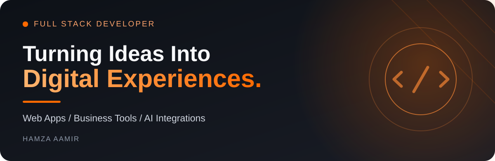
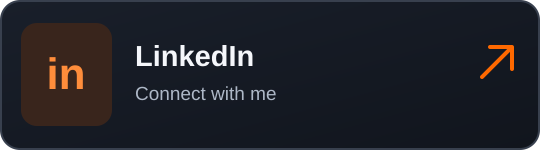
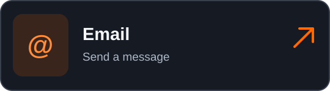
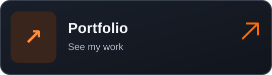
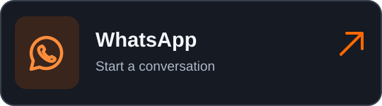

## Hi, I'm Hamza Aamir

I work as a **Full Stack Developer**, building websites, web applications, and tools that help businesses manage their work more easily.

I work on both frontend and backend development, from building responsive interfaces to developing APIs, working with databases, and connecting different services. I also work with **AI integrations**, including chatbots, automated workflows, and AI features in web applications.

I also help improve existing applications by adding features, fixing issues, and making them faster and easier to use.

---

## Technologies & Tools

#### Frontend

<table><tr>
<td align="center" width="110"> <b>HTML</b></td><td align="center" width="110"> <b>CSS</b></td><td align="center" width="110"> <b>JavaScript</b></td><td align="center" width="110"> <b>TypeScript</b></td><td align="center" width="110"> <b>React</b></td><td align="center" width="110"> <b>Next.js</b></td>
</tr></table>

<table><tr>
<td align="center" width="110"> <b>Tailwind CSS</b></td><td align="center" width="110"> <b>Motion</b></td><td align="center" width="110"> <b>Vite</b></td>
</tr></table>

#### Backend & Databases

<table><tr>
<td align="center" width="110"> <b>Node.js</b></td><td align="center" width="110"> <b>Express.js</b></td><td align="center" width="110"> <b>PostgreSQL</b></td><td align="center" width="110"> <b>MongoDB</b></td>
</tr></table>

#### AI & Integrations

<table><tr>
<td align="center" width="110"> <b>AI Integrations</b></td><td align="center" width="110"> <b>AI Chatbots</b></td><td align="center" width="110"> <b>Workflow Automation</b></td><td align="center" width="110"> <b>REST APIs</b></td><td align="center" width="110"> <b>Third Party APIs</b></td>
</tr></table>

#### Other Tools

<table><tr>
<td align="center" width="110"> <b>Git</b></td><td align="center" width="110"> <b>GitHub</b></td><td align="center" width="110"> <b>Shopify</b></td><td align="center" width="110"> <b>Postman</b></td><td align="center" width="110"> <b>VS Code</b></td><td align="center" width="110"> <b>Vercel</b></td>
</tr></table>

---

## What I Build

| Websites & Web Apps                                          | Business Systems                                             |
| :----------------------------------------------------------- | :----------------------------------------------------------- |
| Responsive websites, dashboards, and full stack applications | CRM systems, booking tools, admin panels, and internal tools |
| **APIs & Integrations**                                      | **AI Features & Automation**                                 |
| Backend APIs and connections with other services             | Chatbots, AI features, and automated workflows               |

---

## Let's Connect

Have a project, a remote job opportunity, or something you'd like to discuss? Feel free to reach out.

<table>
<tr>
<td width="50%"></td>
<td width="50%"></td>
</tr>
<tr>
<td width="50%"></td>
<td width="50%"></td>
</tr>
</table>
